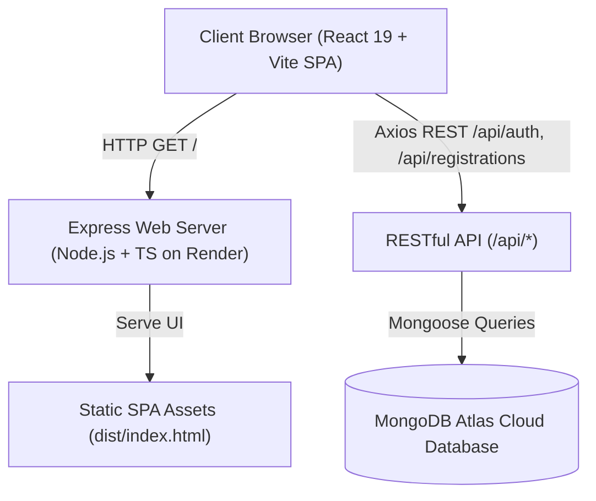

# 🚀 NxtWave AI Workshop — Growth & Registration Platform

[](https://ai-workshop-3osh.onrender.com)
[](https://www.typescriptlang.org/)
[](https://react.dev/)
[](https://tailwindcss.com/)
[](https://nodejs.org/)
[](https://www.mongodb.com/atlas)

A full-stack, production-grade growth marketing and event registration platform built for the **"Build Your First AI Project in 60 Minutes"** campaign. Designed to scale organic student acquisition through automated referral loops, campus ambassador workflows, real-time analytics, and budget tracking.

---

## 🌐 Live Demo & Deployment

| Resource | Link |
|---|---|
| **Live Web App** | [https://ai-workshop-3osh.onrender.com](https://ai-workshop-3osh.onrender.com) |
| **GitHub Repository** | [balaji490/AI-WORKSHOP](https://github.com/balaji490/AI-WORKSHOP) |
| **Admin Login** | [https://ai-workshop-3osh.onrender.com/admin/login](https://ai-workshop-3osh.onrender.com/admin/login) |
| **User Registration** | [https://ai-workshop-3osh.onrender.com/signup](https://ai-workshop-3osh.onrender.com/signup) |
| **Health Check API** | [https://ai-workshop-3osh.onrender.com/api/health](https://ai-workshop-3osh.onrender.com/api/health) |

### 🔑 Demo Credentials

| Role | Email | Password | Quick Access |
|---|---|---|---|
| **Platform Admin** | `admin@nxtwave.tech` | `Admin@123456` | Click **Auto-fill** on the Admin Login page |
| **Student** | Any email | Any password | Sign up at `/signup` or use existing account |

---

## 🎯 Campaign Objectives

- **Target Registrations**: 500+ final-year engineering students
- **Campaign Timeline**: 7-day promotional window
- **Maximum Marketing Budget**: ₹2,000 (Target Cost Per Registration: < ₹4.00)
- **Primary Acquisition Channels**: WhatsApp Communities, Campus Ambassadors, College Clubs, and Peer-to-Peer Referrals

---

## 🛠 Skills & Technical Capabilities Demonstrated

### 1. Frontend Engineering
- **Modern UI/UX**: Built with **React 19**, **Vite**, and **TypeScript**, styled using a custom design system with **Tailwind CSS v4** and glassmorphism.
- **Dynamic Animations**: Fluid transitions with **Framer Motion** and responsive data visualization using **Recharts**.
- **Component Architecture**: Modular, reusable components with Radix UI accessibility primitives and Lucide icons.
- **State Management & Routing**: Robust client-side routing with **React Router v6** and context-driven authentication.

### 2. Backend & Systems Architecture
- **Enterprise Node.js + Express**: Scalable RESTful API written strictly in **TypeScript**.
- **Resilient Database Layer**: **MongoDB** with **Mongoose ODM**, connection retry loops, and optimized indexing.
- **Auto-Bootstrapping**: Automatic database seeding on startup for default admin accounts, campaigns, and workshop templates.
- **Unified Monorepo Deployment**: Dual-mode serving where Express serves the compiled React single-page application and API from a single host, eliminating CORS latency and cookie blocking.

### 3. Security & Compliance
- **Authentication**: JWT token lifecycle management with HTTP-only, secure, SameSite cookies and localStorage fallback.
- **Password Security**: Strong salt hashing with **bcrypt** (12 rounds).
- **Data Integrity & Validation**: Type-safe schema validation powered by **Zod**.
- **Defense-in-depth**: **Helmet** security headers, CORS origin controls, and Express rate limiting on sensitive auth endpoints.

### 4. Growth Marketing & Product Mechanics
- **Viral Referral Engine**: Custom unique referral codes per student with instant 1-click WhatsApp and social sharing.
- **Attribution & Anti-Fraud**: Strict prevention of self-referrals and duplicate attributions with transactional integrity.
- **Real-Time Growth Dashboard**: Visual funnel metrics, daily registration velocity, channel breakdowns, and cost-per-registration calculations.
- **Data Portability**: Instant CSV export of participant data for marketing CRM workflows.

---

## 🏛 System Architecture



---

## 📱 Application Pages & Routes

| Route | Access | Purpose |
|---|---|---|
| `/` | Public | High-converting workshop landing page with agenda, mentors, roadmap, and FAQs |
| `/signup` | Public | Student signup with college, branch, and referral code auto-fill |
| `/login` | Public | Student login with clear status indicators |
| `/onboarding` | Authenticated | 1-click workshop confirmation and instant referral link generator |
| `/dashboard` | Authenticated | Student dashboard tracking referral credits, rank, and workshop prep |
| `/r/:code` | Public | Referral landing route that auto-attributes credit on signup |
| `/admin/login` | Public | Secure admin login with 1-click credential auto-fill |
| `/admin` | Admin | Real-time growth analytics, daily velocity charts, and budget tracker |
| `/admin/registrations` | Admin | Searchable, paginated registration table with CSV export |
| `/admin/ambassadors` | Admin | Campus ambassador management and custom code generation |
| `/admin/campaigns` | Admin | Channel budget allocation and promotional message templates |

---

## 📂 Project Structure

```
├── backend/
│   ├── src/
│   │   ├── config/          # MongoDB connection & retry handler
│   │   ├── middleware/      # Auth, error handling, rate limiting
│   │   ├── models/          # User, Workshop, Registration, Referral, Campaign
│   │   ├── routes/          # REST endpoints (auth, user, admin, workshops)
│   │   ├── scripts/         # Standalone database seeders
│   │   ├── utils/           # Zod validation schemas and helpers
│   │   └── index.ts         # Express server, CORS & static frontend serving
│   ├── package.json
│   └── tsconfig.json
│
├── frontend/
│   ├── src/
│   │   ├── components/      # Navbar, Footer, Skeletons, ProtectedRoute
│   │   ├── context/         # AuthContext and ToastContext
│   │   ├── lib/             # Axios API client and helper functions
│   │   ├── pages/           # Landing, Dashboard, Admin, Onboarding, Login
│   │   ├── App.tsx          # Router configuration
│   │   └── index.css        # Tailwind CSS v4 & custom glassmorphism styles
│   ├── package.json
│   └── vite.config.ts
│
├── package.json             # Root orchestrator for single-service build
└── README.md
```

---

## 💻 Local Development Setup

### Prerequisites
- **Node.js**: v18 or higher
- **MongoDB**: Local MongoDB instance or free MongoDB Atlas cluster

### 1. Clone Repository
```bash
git clone https://github.com/balaji490/AI-WORKSHOP.git
cd AI-WORKSHOP
```

### 2. Configure Environment Variables
Create `backend/.env`:
```env
PORT=5000
NODE_ENV=development
MONGODB_URI=mongodb://localhost:27017/nxtwave-workshop
JWT_SECRET=dev-jwt-secret-change-in-production
JWT_REFRESH_SECRET=dev-refresh-secret-change-in-production
JWT_EXPIRES_IN=15m
JWT_REFRESH_EXPIRES_IN=7d
FRONTEND_URL=http://localhost:5173
ADMIN_EMAIL=admin@nxtwave.tech
ADMIN_PASSWORD=Admin@123456
```

### 3. Install & Run
```bash
# Install all dependencies and run dev servers:
npm run build    # Builds both frontend and backend
npm start        # Starts the unified server on http://localhost:5000
```
Or run individually:
- Backend: `cd backend && npm run dev` (Runs on port 5000)
- Frontend: `cd frontend && npm run dev` (Runs on port 5173 with proxy to 5000)

---

## ☁️ Deployment on Render

This project is configured to deploy as a **Single Web Service** on Render with zero external dependencies:

1. Connect `balaji490/AI-WORKSHOP` on [Render](https://dashboard.render.com).
2. Set **Runtime**: `Node`
3. Set **Build Command**: `npm run build`
4. Set **Start Command**: `npm start`
5. Configure Environment Variables:
   - `NODE_ENV`: `production`
   - `MONGODB_URI`: `mongodb+srv://<user>:<password>@cluster.mongodb.net/nxtwave?retryWrites=true&w=majority`
   - `JWT_SECRET`: *(your secret)*
   - `JWT_REFRESH_SECRET`: *(your refresh secret)*

---

## 📄 License & Credits

Developed for the **NxtWave Growth Intern Challenge**.  
All rights reserved © 2026 Balaji Narra.
